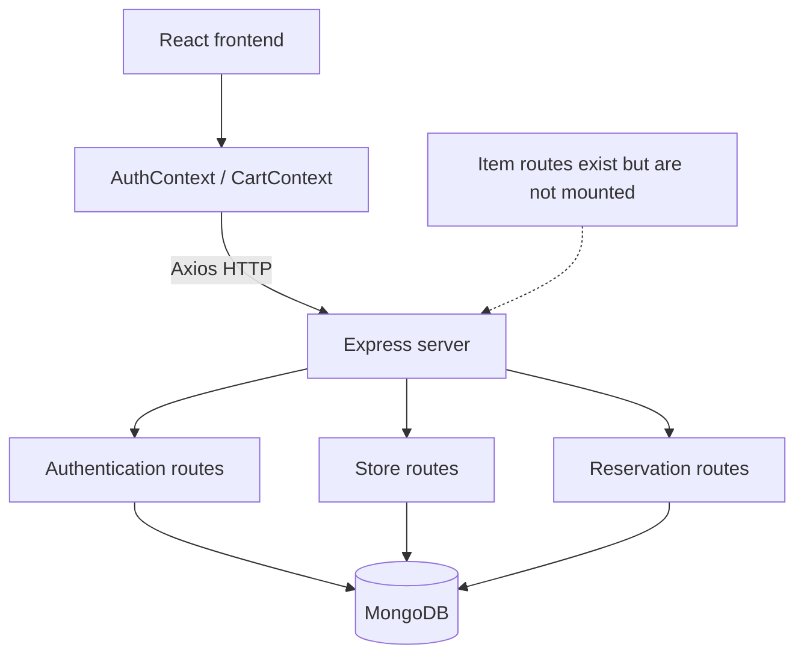
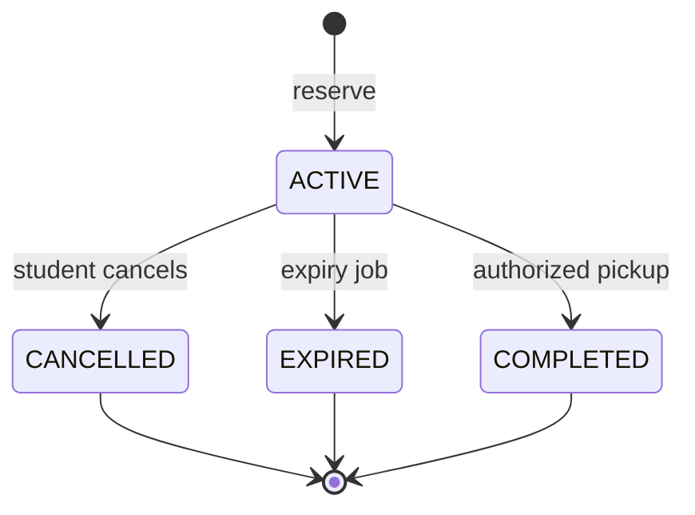
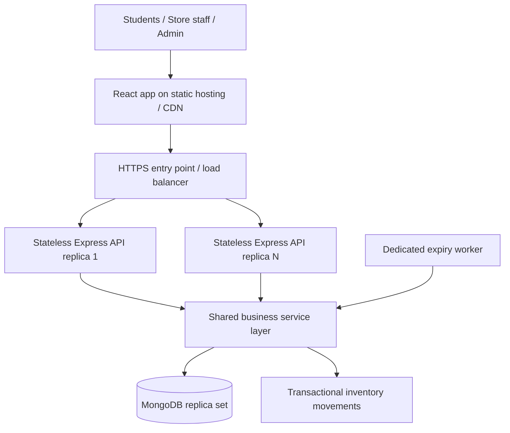

# CampusMart

**Campus Store Inventory & Reservation Management System**

> **Status: Functional prototype · Not yet production-ready**  
> **Stack:** React 19, React Router, Node.js, Express 5, MongoDB, Mongoose, JWT, Axios  
> **Repository:** [SudarshanG9/CampusMart](https://github.com/SudarshanG9/CampusMart)  
> **Code audit baseline:** `main` at `29b51174c3f5324bc29d38c73356008fa3811ea0` (reviewed November 2026)

CampusMart is a full-stack campus inventory and reservation application that helps students discover available products across campus stores and place temporary holds on items. The existing system demonstrates the core client–server–database workflow: student login, catalog browsing, reservation creation, active-reservation viewing, and cancellation. The broader engineering objective is to turn this prototype into a **secure, concurrency-safe, auditable, and horizontally scalable multi-store reservation platform**, with owner-managed inventory, automatic hold expiry, reliable pickup fulfillment, and measurable operational performance.

> [!IMPORTANT]
> This README deliberately distinguishes **implemented functionality** from **planned engineering work**. Transactional reservations, background expiry recovery, store-owner management, CI/CD, production deployment, and performance figures are **not claimed as completed**. The currently tracked backend environment file also requires credential rotation and repository hygiene before any real-world deployment.

---

## Table of contents

1. [Problem statement and vision](#problem-statement-and-vision)
2. [Technology stack](#technology-stack)
3. [Current implementation status](#current-implementation-status)
4. [Current architecture](#current-architecture)
5. [Project structure](#project-structure)
6. [Getting started locally](#getting-started-locally)
7. [Existing API reference](#existing-api-reference)
8. [Data model and business rules](#data-model-and-business-rules)
9. [Technical limitations and risks](#technical-limitations-and-risks)
10. [Target architecture and design decisions](#target-architecture-and-design-decisions)
11. [Planned features and technical optimizations](#planned-features-and-technical-optimizations)
12. [Implementation roadmap](#implementation-roadmap)
13. [Testing and benchmark strategy](#testing-and-benchmark-strategy)
14. [Production readiness criteria](#production-readiness-criteria)
15. [Engineering outcomes and evidence](#engineering-outcomes-and-evidence)

---

## Problem statement and vision

Campus retail environments often rely on students visiting stores to check availability. This creates unnecessary trips, uncertainty around stock, and difficulty coordinating pickups at high-demand periods. CampusMart aims to expose a unified inventory catalog while supporting **time-bound reservations** across multiple campus stores.

The long-term platform will support three roles:

| Role | Intended experience |
| --- | --- |
| **Student** | Authenticate, browse stores and items, reserve stock, monitor holds, cancel reservations, and view history. |
| **Store owner/staff** | Maintain the catalog, replenish stock, view incoming reservations, confirm pickups, and inspect stock changes. |
| **Administrator** | Provision stores and operators, manage permissions, investigate discrepancies, and monitor service health. |

**Engineering priorities:** inventory correctness under concurrency; safe reservation state transitions; account and store isolation; auditability; controlled background recovery; reproducible deployments; and realistic scalability measurements.

### Scope boundaries

CampusMart is currently a **reservation and inventory** application, not a full payment-processing or order-shipping platform. Payment gateways, delivery tracking, advanced recommendations, multi-region deployment, and microservices are **not necessary** for the first reliable release.

---

## Technology stack

| Area | Current technology | Evolution path |
| --- | --- | --- |
| Frontend | React 19, React Router 7, CSS | Retain React; improve component structure, accessibility, and loading/error states. |
| Frontend build | Create React App (`react-scripts` 5) | Migrate to Vite after correctness and security work. |
| HTTP client | Axios | Introduce a centralized client and, if useful, TanStack Query for server-state management. |
| Backend | Node.js, Express 5 | Keep a modular monolith; split routes, controllers, validation, and services. |
| Database | MongoDB + Mongoose 8 | Add replica-set transactions, conditional updates, indexes, migration and reconciliation tools. |
| Authentication | bcrypt password comparison, JWT | Centralize middleware; establish secure session transport and server-enforced authorization. |
| Background tasks | None | Dedicated, retry-safe reservation-expiry worker, initially with a 5-minute schedule. |
| Testing | CRA starter test; no working backend test suite | Unit, integration, concurrency, end-to-end, and load testing. |
| Operations | No verified release automation | CI/CD, environment validation, health checks, logs, metrics, backup and recovery. |

**Why a modular monolith?** Inventory and reservations share one transactional data model. Separating them into independent network services now would add distributed consistency complexity without demonstrated scaling benefits. Multiple **stateless API instances** can be deployed later without decomposing the application into microservices.

---

## Current implementation status

### Implemented in the audited repository

| Function | Existing behavior | Qualification |
| --- | --- | --- |
| Student login | Checks SRN against MongoDB, compares bcrypt hash, issues 1-hour JWT. | Login works at code level; security hardening and session verification remain. |
| Campus store listing | Reads stores through `GET /api/stores`. | Database-backed. |
| Store catalog | Reads one store and its items through `GET /api/stores/:id`. | No pagination or advanced search. |
| Reservation creation | Authenticated student requests a quantity; item stock is decremented and a reservation record is inserted. | **Read–modify–write is not atomic.** |
| Active reservation list | Reads student's `ACTIVE` reservations and populates item data. | Expired records are not automatically transitioned. |
| Manual cancellation | Restores item stock and deletes reservation document. | Not transactional or idempotent; deletes history. |
| Reservation countdown | Browser displays time until the stored expiration timestamp. | Visual only; does not trigger stock restoration. |
| Product-management code | POST/DELETE item route handlers exist. | Router is **not mounted** in the main server; ownership checks are missing. |
| Student UI | Login page, store dashboard, store page, cart/reservation modals. | Needs robust error/loading/empty states. |

### Missing or unfinished

| Capability | Status |
| --- | --- |
| Atomic inventory reservation and cancellation | **Not implemented** |
| Server-side reservation expiry and automatic stock restoration | **Not implemented** |
| Completed pickup/fulfillment workflow | **Not implemented** |
| Store-owner authentication and scoped permissions | **Not implemented** |
| Store-owner create/update/restock/archive interface | **Incomplete** |
| Inventory movement/audit log | **Not implemented** |
| Reservation history with cancelled/expired/completed states | **Incomplete** |
| Automated backend tests, concurrency tests and load tests | **Not implemented** |
| CI/CD, deployment manifests, logging/metrics/alerts | **Not implemented / not evidenced** |
| Verified public production deployment | **Not evidenced** |

### Development maturity

**Prototype:** Basic data flow is present. **Release blocker:** inventory operations can violate correctness under concurrent demand. The project should not be described as production-ready until security, transaction safety, lifecycle completeness, automated tests, and deployment gates have been satisfied.

---

## Current architecture



The backend currently places business logic directly inside Express route handlers. This works for a small prototype but makes it harder to enforce the same rules consistently for cancellation, expiry, fulfillment, and restocking.

**Important frontend detail:** `AuthProvider` is mounted in both `mini-project/src/index.js` and `mini-project/src/App.js`; this creates duplicate provider instances and should be consolidated.

---

## Project structure

### Present structure (selected files)

```text
CampusMart/
├── mini-project/                  # React frontend
│   ├── public/images/           # Product images
│   ├── src/
│   │   ├── components/          # Header, cart and reservation modals
│   │   ├── context/             # AuthContext, CartContext
│   │   ├── data/mockData.js     # Development fixtures
│   │   ├── pages/               # Student login, dashboard, store page
│   │   ├── App.js
│   │   └── index.js
│   ├── package.json
│   └── README.md                 # Existing CRA-generated guide
├── server/
│   ├── middleware/
│   ├── models/                  # Student, Store, Item, Reservation
│   ├── routes/                  # Auth, stores, items, reservations
│   ├── auth.middleware.js       # Separate legacy auth implementation
│   ├── seed.js
│   ├── server.js
│   ├── test-server.js
│   └── package.json
└── package.json                 # Root manifest (not a complete workspace)
```

The repository also has committed `node_modules` directories and a tracked `server/.env`; these should be removed from version control as part of security/hygiene work. Removing a tracked file alone does not remove historical exposure.

### Proposed structure (future work)

```text
CampusMart/
├── mini-project/src/
│   ├── api/                     # Shared HTTP client + resource APIs
│   ├── components/
│   ├── context/
│   ├── hooks/
│   └── pages/
│       ├── student/
│       ├── owner/
│       └── admin/
├── server/
│   ├── config/                  # DB, validated environment
│   ├── controllers/             # HTTP request/response mapping
│   ├── services/                # Inventory, reservation, auth, store logic
│   ├── models/                  # Current + inventory movement model
│   ├── middleware/              # AuthN, AuthZ, validation, errors
│   ├── validators/              # Input schemas
│   ├── routes/
│   ├── jobs/                    # Expiry processing
│   ├── scripts/migrations/
│   ├── tests/
│   ├── app.js                   # Express app configuration
│   ├── server.js                # HTTP process bootstrap
│   └── worker.js                # Independent worker process
├── .github/workflows/          # Build, tests, security checks
├── tests/load/                 # k6 / Artillery scenarios
├── .env.example
├── .gitignore
└── README.md
```

**Design constraint:** Migrate incrementally. Do not change all folder names and interfaces at once; extract an existing route into a service when its business rule is being secured or tested.

---

## Getting started locally

> [!WARNING]
> The application has not been verified through an automated clean-install and integration pipeline. The steps below describe the current entry points, not a guaranteed fully automated setup.

### Prerequisites

- Node.js and npm compatible with the checked-in dependencies (prefer a supported Node LTS and validate against CRA's toolchain).
- MongoDB development database (local or Atlas).
- A seeded student account; no self-service signup route currently exists.

### 1. Clone the repository

```bash
git clone https://github.com/SudarshanG9/CampusMart.git
cd CampusMart
```

### 2. Configure the backend

Create a **local-only** `server/.env` with new development credentials. Never use previously exposed credentials or commit this file.

```dotenv
MONGO_URI=mongodb://127.0.0.1:27017/campusmart_dev
JWT_SECRET=replace-with-a-long-random-dev-secret
PORT=5001
```

In production, use your hosting provider's secret management rather than a committed `.env`. Rotate the credentials exposed in the existing tracked file before making the repository safe for reuse.

### 3. Run the backend

```bash
cd server
npm ci
node server.js
```

The backend defaults to **port 5001** and currently has **no `npm start` script**. It also does not yet wait for a successful MongoDB connection before beginning to listen. These issues are tracked in the roadmap.

### 4. Run the frontend

Open a separate terminal from the repository root:

```bash
cd mini-project
npm ci
npm start
```

The frontend typically serves at **http://localhost:3000**. Its API requests currently use **http://localhost:5001** directly. An environment-driven API client is planned.

### 5. Development data and login

`server/seed.js` is intended to load demonstration stores, products and hashed student credentials from the frontend fixture file. **It deletes all existing stores, items and students before inserting fresh data.** Use only an isolated, disposable development database and take backups first.

**Compatibility caveat:** The seed script uses CommonJS `require()` to import an ES-module-style frontend fixture. Its behavior depends on the Node.js runtime/module configuration and requires validation or refactoring. The following is a *candidate* command, not a verified safe routine:

```bash
# ONLY against an isolated disposable development database
cd server
node seed.js
```

If seeding fails, fix the fixture/module boundary as a separate task; do not run destructive seed scripts repeatedly against a shared database.

### 6. Smoke-test endpoints

```bash
# Store listing
curl http://localhost:5001/api/stores

# Authenticate with a real development account
curl -X POST http://localhost:5001/api/auth/login \
  -H 'Content-Type: application/json' \
  -d '{"srn":"YOUR_TEST_SRN","password":"YOUR_TEST_PASSWORD"}'
```

Authenticated reservation requests currently use:

```http
Authorization: Bearer <JWT_FROM_LOGIN>
```

### Existing test/build commands

```bash
cd mini-project
npm run build
npm test
```

The single checked-in frontend test checks for a default Create React App starter link and needs replacement. The backend's `npm test` script is currently a placeholder that intentionally exits with failure; **there is no working backend automated test suite yet**.

---

## Existing API reference

The following routes are registered by `server/server.js` in the audited code:

| HTTP | Endpoint | Auth | Current behavior |
| --- | --- | --- | --- |
| `POST` | `/api/auth/login` | No | Verify SRN/password; return JWT and student identifier. |
| `GET` | `/api/stores` | No at API level | Return stores. |
| `GET` | `/api/stores/:id` | No at API level | Return store and its items. |
| `POST` | `/api/reservations` | JWT | Reserve stock and insert an `ACTIVE` reservation. |
| `GET` | `/api/reservations/my-reservations` | JWT | Return this student's active reservations. |
| `DELETE` | `/api/reservations/:id` | JWT | Restore stock and delete an owned reservation. |

**Route not mounted:** `server/routes/items.js` defines `POST /` and `DELETE /:id` internally, but `server/server.js` never mounts that router. Product management must be authorized and integrated before exposing those routes.

### Example reservation request (existing)

```http
POST /api/reservations
Authorization: Bearer <token>
Content-Type: application/json

{
  "itemId": "<existing-item-object-id>",
  "quantity": 1
}
```

In the present backend, reservation expiry is hardcoded to **10 minutes**, even though the frontend selector shows 5, 8 and 10 minutes. The selected duration is not sent in the POST payload.

### Planned API endpoints (not available today)

| HTTP | Proposed endpoint | Purpose |
| --- | --- | --- |
| `GET` | `/api/auth/me` | Verify active authenticated session. |
| `POST` | `/api/reservations/:id/cancel` | Idempotent, audited cancellation. |
| `POST` | `/api/reservations/:id/complete` | Authorized pickup/fulfillment. |
| `GET` | `/api/reservations/history` | Student reservation history. |
| `GET` | `/api/stores/:storeId/reservations` | Owner reservation queue. |
| `POST` | `/api/stores/:storeId/items` | Owner creates item. |
| `PATCH` | `/api/stores/:storeId/items/:itemId` | Owner edits item metadata. |
| `POST` | `/api/stores/:storeId/items/:itemId/restock` | Record incoming stock. |
| `POST` | `/api/stores/:storeId/items/:itemId/adjust` | Authorized stock correction. |
| `PATCH` | `/api/stores/:storeId/items/:itemId/archive` | Soft-delete or archive product. |
| `GET` | `/api/stores/:storeId/inventory-movements` | Auditable movement history. |
| `GET` | `/health/live`, `/health/ready` | Liveness and readiness probes. |

The exact REST naming and session transport should be finalized while implementing the corresponding business service. **Clients cannot rely on these proposed endpoints yet.**

---

## Data model and business rules

### Existing MongoDB schemas

| Collection/model | Current fields |
| --- | --- |
| Student | `srn`, `password` (stored as a bcrypt hash when seeded) |
| Store | `name` (unique) |
| Item | `name`, `quantity`, `price`, `imageUrl`, `store` |
| Reservation | `student`, `item`, `quantityReserved`, `expiresAt`, `status`, timestamps |

The reservation schema permits `ACTIVE`, `EXPIRED`, and `COMPLETED`, but server-side transitions to the latter two statuses are not implemented. There is no `CANCELLED` status in the current schema; cancellation instead deletes the record.

### Current reservation write path (unsafe under concurrency)

```text
Read item and quantity
        ↓
Check available stock in application memory
        ↓
Subtract requested quantity
        ↓
Save item
        ↓
Insert reservation
```

For example, two requests can independently read stock of one, both pass the check, both write stock zero, and both create reservations. **The stored quantity need not become negative for overselling to occur.** Unvalidated negative request quantities can also incorrectly increase inventory.

### Target inventory accounting

The planned model will distinguish:

- `onHand`: physically present stock.
- `reserved`: stock held for active reservations.
- `available`: stock available for new reservations.

With the invariant:

```text
onHand = available + reserved
available >= 0
reserved >= 0
```

| Business event | Available | Reserved | On-hand |
| --- | ---: | ---: | ---: |
| Reserve `q` | `−q` | `+q` | unchanged |
| Cancel/expire `q` | `+q` | `−q` | unchanged |
| Fulfill pickup `q` | unchanged | `−q` | `−q` |
| Receive `q` units | `+q` | unchanged | `+q` |

Counters must remain synchronized transactionally; do not add redundant stock fields without a controlled migration and consistency checks. Record an **inventory movement** for every successful stock change, with actor, reason, quantity, item, store, reservation reference (when relevant), and timestamp.

### Target reservation state machine



Terminal transitions should be **single-winner, idempotent, and atomic with stock effects**. Pickup must validate the expiration timestamp even if the expiry worker has not yet caught up.

---

## Technical limitations and risks

All of the following are **open findings at the audited revision**, not resolved issues.

| Priority | Finding | Why it matters |
| --- | --- | --- |
| **P0** | Reservations use non-atomic stock reads and saves. | Concurrent holds can oversell an item. |
| **P0** | No positive-integer server validation for quantity. | Negative/fractional values can corrupt stock. |
| **P0** | Cancellation restores stock then deletes reservation in separate operations. | Retries/races can miscount stock and lose audit history. |
| **P0** | No expiry worker despite `expiresAt` timestamps. | Abandoned holds indefinitely retain stock. |
| **P0** | Previously committed `server/.env` secrets. | Credentials must be rotated and history assessed. |
| **P0** | Item write API lacks ownership checks and is not mounted. | Missing usable inventory administration; potential authorization risk when exposed. |
| **P1** | UI authentication relies on a stored SRN and duplicate `AuthProvider`s exist. | Session and state can be misleading. |
| **P1** | Backend CORS is unrestricted; frontend URLs are hardcoded. | Weak deployment configuration and origin policy. |
| **P1** | No implemented completion/pickup workflow. | Reservations cannot progress to verified fulfillment. |
| **P1** | No movement ledger, reconciliation tool, or safe restocking flow. | Inventory changes are difficult to explain or recover. |
| **P1** | No backend automated tests, meaningful frontend tests or CI. | Correctness and regressions cannot be verified systematically. |
| **P1** | Server listens before confirmed DB readiness. | Application may appear healthy while DB is unavailable. |
| **P1** | Destructive seed routine; fixture imports cross runtime/module boundaries. | Risk of data loss and setup failures. |
| **P1** | No rate limiting or explicit role/store authorization. | Credential abuse and cross-store mutation risks. |
| **P1** | No idempotency keys or duplicate-submission protection. | Retries may create multiple valid holds. |
| **P2** | No paging, targeted compound indexes or query metrics. | Catalog and history queries become expensive with data growth. |
| **P2** | No request IDs, structured logs, worker metrics or alerts. | Operational failures may go undetected. |
| **P2** | No configured build/deploy/recovery pipeline. | Releasing and rolling back cannot be reproduced reliably. |
| **P2** | Frontend has incomplete error handling and potential null populated item references. | Poor UX and avoidable crashes. |
| **P2** | Create React App toolchain, duplicated/unused files, committed dependencies. | Maintenance and repository hygiene issues. |

**Security note:** CORS is not an authorization system. Restricting origins is still useful for browser deployments, but every protected API operation must independently validate identity and permissions.

---

## Target architecture and design decisions



### 1. Modular monolith, not microservices

Adopt **routes → controllers → services → Mongoose models**. Controllers manage HTTP concerns; services own reservation invariants, authorization-sensitive actions, and inventory transitions. API processes and the worker invoke the same service rules.

### 2. MongoDB transactions + conditional stock updates

A reservation should atomically:

1. Validate requested quantity and current user's permissions.
2. Start a database session transaction.
3. Conditionally decrement available stock (`quantity >= requested`) using an atomic update.
4. Create the reservation and movement/audit record inside the same transaction.
5. Commit and return success only after the transaction commits.

Write conflicts and transient transaction errors need bounded retries. MongoDB transactions require a compatible replica-set or sharded deployment; standalone MongoDB is insufficient for the intended transaction tests.

### 3. Idempotency for writes

Use request idempotency keys with database-enforced deduplication for reservation creation. Cancellation, expiration and fulfillment must be conditional transitions from `ACTIVE`, so repeating a request never repeats its stock effect. Distinguish **duplicate calls** from **competing legitimate requests**.

### 4. Store-scoped authorization

Introduce roles (`STUDENT`, `OWNER`, `ADMIN`) and associate store managers with authorized stores. Authenticate at the API boundary and authorize each resource mutation in the service/controller path. A token proving identity does not automatically grant permission to edit any store.

### 5. Expiry as a server-owned lifecycle

Run a dedicated Node.js worker every five minutes. Query indexed active reservations whose `expiresAt` is in the past, process in bounded batches, and transactionally move each to `EXPIRED` while restoring stock **exactly once**. Repeated worker runs and concurrent cancellations must remain safe. TTL indexes alone cannot restore inventory.

### 6. Database access and indexing

Start with indexes driven by measured queries:

- `items(store)` and optionally unique `(store, sku)`.
- `reservations(student, status, createdAt)`.
- `reservations(status, expiresAt)` for expiry sweeps.
- `reservations(store, status, createdAt)` if store is denormalized into reservation records.
- A unique, appropriately scoped idempotency key index.

Inspect query plans with MongoDB `explain()`. Add pagination and bounded page sizes before introducing a cache. Database writes remain the source of truth for stock availability regardless of frontend caching.

### 7. Operational reliability

Use environment validation, readiness/liveness probes, graceful shutdown, bounded connection pools, database backups with tested restoration, structured logs, alerts and a documented incident-recovery procedure. Separate staging and production configuration and run schema migrations deliberately.

### 8. Scaling principles

Add API replicas behind a load balancer for horizontally scalable stateless reads and independent requests. A **hot inventory item** can still be a database contention point; extra API replicas alone cannot eliminate that serialization requirement. Only introduce Redis, queues, sharding or sophisticated caching after load tests demonstrate a clear bottleneck and a correctness-preserving mitigation.

---

## Planned features and technical optimizations

### Product and workflow capabilities

| Capability | Target behavior | Priority |
| --- | --- | --- |
| Owner product management | Create, update metadata, archive products. | P0 |
| Restocking and stock corrections | Role-checked, reason-coded, auditable stock movements. | P0 |
| Pickup fulfillment | Authorized `ACTIVE → COMPLETED` transition with correct physical stock effect. | P0 |
| Automatic expiry | Release unused holds without manual database intervention. | P0 |
| Reservation history | Show cancelled, expired and completed holds; preserve audit data. | P1 |
| Owner reservation queue | View and process pending pickups by store. | P1 |
| Student account/session verification | Validate identity on reload and handle expiry/logout safely. | P1 |
| Search, sorting, pagination | Efficient navigation across large catalogs. | P1 |
| Low-stock thresholds | Surface items that require replenishment. | P2 |
| Pickup codes and notifications | Optional confirmation UX and reminders. | P2 |
| Multi-campus administration | Extend store ownership/tenant model if needed. | Future |
| Payments/delivery/recommendations | Not in initial production scope. | Future |

### Performance and maintainability work

| Change | Objective | Measure |
| --- | --- | --- |
| Atomic conditional writes | Prevent overselling. | Inventory invariant violations = 0 in test runs. |
| Short MongoDB transactions | Avoid partial writes with manageable contention. | p95 write latency, retries, conflicts. |
| Compound indexes and pagination | Efficient listings and expiry scanning. | Query plan, p95 read latency, scanned documents. |
| Dedicated bounded expiry batches | Predictable restoration even with backlog. | Expiry lag and failed batches. |
| Central Axios API client | Consistent URLs, auth and error handling. | Integration/E2E outcomes. |
| Optional TanStack Query | Revalidate server-backed state after mutations. | Redundant fetches, stale-state defects. |
| Migrate CRA → Vite | Cleaner supported build workflow. | Build reliability/time. |
| Request/worker observability | Detect service, database and scheduler failures. | Error, lag, and availability dashboards. |
| CI/CD and migration scripts | Repeatable, reviewable releases. | Passing checks and staging smoke tests. |

---

## Implementation roadmap

Work in dependency order: **secure and validate → define stock semantics → make writes atomic → implement lifecycle → finish workflows → optimize/deploy → prove scaling**.

### Phase 0 — Security and foundation

- [ ] Rotate tracked secrets and remove secret/dependency artifacts from active and historical version control as appropriate.
- [ ] Add root `.gitignore`, placeholder `.env.example`, dependency/toolchain policy.
- [ ] Create `app.js`/`server.js` boundary and environment validation.
- [ ] Wait for DB readiness, add health probes and graceful shutdown.
- [ ] Consolidate authentication middleware and duplicate frontend providers.
- [ ] Implement role/store authorization, request validation and standardized errors.
- [ ] Establish isolated development, test and staging databases.

**Acceptance:** clean startup and tests without exposed credentials; invalid requests and unauthorized access are rejected.

### Phase 1 — Inventory accounting and safe reservations

- [ ] Design available/reserved/on-hand stock fields and movement records.
- [ ] Write a data reconciliation and migration script for existing stock/reservations.
- [ ] Extract inventory and reservation services from Express routes.
- [ ] Implement conditional decrement and reservation insertion in one transaction.
- [ ] Add idempotency keys for repeated reservation creation.
- [ ] Replace delete-on-cancel with `ACTIVE → CANCELLED` and transactional restoration.
- [ ] Add query/uniqueness indexes and concurrency regression tests.

**Acceptance:** no overselling or duplicate restoration under repeated 10/50/100-request contention tests; injected transaction failures leave no partial state.

### Phase 2 — Reservation lifecycle and recovery

- [ ] Implement independent scheduled expiry worker (5-minute interval).
- [ ] Make expiry status transition and stock restoration atomic.
- [ ] Handle cancellation/expiry and completion/expiry races.
- [ ] Enforce expiration during fulfillment, regardless of worker delay.
- [ ] Record expiry counts, failures, backlog, and lag.
- [ ] Test worker restarts, retries, multi-worker overlap and database failures.

**Acceptance:** 15 seeded expired holds can be restored once; repeat runs and concurrent actions cannot over-credit stock. This **does not establish** an operational average of 15 expirations/day.

### Phase 3 — Operational store workflows

- [ ] Finish owner/staff authorization and store administration.
- [ ] Integrate item create/update/archive/restock/adjust endpoints.
- [ ] Implement owner reservation queue and pickup completion.
- [ ] Add history and auditable inventory movements.
- [ ] Implement student and owner UI flows with loading/error states.
- [ ] Add cross-store authorization and end-to-end integration tests.

**Acceptance:** complete student reservation → pickup/cancellation/expiry flows and owner stock management, with auditable accounting.

### Phase 4 — Frontend architecture and database optimization

- [ ] Centralize environment-driven API calls.
- [ ] Add server-state revalidation and prevent double submissions.
- [ ] Migrate CRA to Vite and verify asset paths and SPA routing.
- [ ] Add indexed queries, pagination and selective field projections.
- [ ] Tune MongoDB connection pools and transaction retry policy based on measurements.
- [ ] Add frontend component tests and browser end-to-end tests.

**Acceptance:** stable production build and predictable catalog/owner operations with representative test data.

### Phase 5 — Deployment, resilience, and measurement

- [ ] Configure CI for install, lint, test, build, and security checks.
- [ ] Deploy frontend, stateless API, expiry worker and managed MongoDB to staging.
- [ ] Add secrets, HTTPS, CORS policy, health checks, logs, metrics, alerts and backups.
- [ ] Test outage recovery, worker restarts, rollback and database restoration.
- [ ] Perform representative concurrency and load testing (k6 or Artillery).
- [ ] Optimize only observed bottlenecks and document capacity constraints.
- [ ] Create deployment, runbook, API contract and benchmark evidence docs.

**Acceptance:** staging smoke tests, correctness regression suite, recovery checks, and realistic load tests pass against documented infrastructure.

---

## Testing and benchmark strategy

### Correctness tests (release blockers)

| Test | Scenario | Expected result |
| --- | --- | --- |
| Low-stock contention | 10 concurrent 1-unit requests; stock = 3. | Exactly 3 units reserved; no invariant violation. |
| Hot-item stress | 100 concurrent 1-unit requests; stock = 5. | At most 5 accepted units, with accurate final stock. |
| Request replay | Same idempotency key sent multiple times. | One logical reservation. |
| Cancel race | Two clients cancel the same reservation. | One transition and restoration. |
| Expiry/cancel race | Worker expires while student cancels. | One winner; inventory restored once. |
| Fulfillment/expiry race | Staff confirms pickup as expiry is due. | Exactly one valid terminal outcome. |
| Transaction failure | Error injected between stock and reservation operations. | No partial committed mutation. |
| Invalid input | Negative, zero, fractional or excessive quantities. | Request rejected; stock unchanged. |
| Cross-store action | Owner A tries to edit Store B's inventory. | Forbidden, with no database mutation. |
| Recovery | Worker restarts with expired backlog. | Eventually processed with no duplicates. |

### Load and performance tests

Run realistic mixed workloads across increasing virtual-user levels (for example 10, 50, 100, 250, and 500, subject to available infrastructure). Distinguish store/product reads, authentication, reservations, cancellations, and expiry processing. Record:

- Requests/second and successful operations/second.
- p50/p95/p99 HTTP latency by endpoint and request type.
- HTTP 4xx conflict rates vs unexpected 5xx error rates.
- Inventory invariant violations and duplicate stock effects.
- MongoDB connection count, CPU, scanned documents and transaction retry count.
- Expiry backlog, recovery counts, and time from expiry to restoration.
- Results with one API instance vs multiple replicas on the same documented infrastructure.

Do not claim that 100 or 1,000 virtual users were **supported** without specifying the workload, test duration, hardware, latency/error thresholds and successful invariant checks.

### Metrics and evidence for resume claims

The following are **future evidence goals**, not measured current achievements:

| Proposed claim | Required evidence |
| --- | --- |
| Eliminate race-condition-driven stock errors. | Repeatable baseline and fixed-version runs, database assertions, failure definition. |
| Restore abandoned reservations automatically. | Passed expiry tests and operational metrics for volume and lag. |
| Remediate 15+ production-readiness defects. | Tracked issue list with before/after behavior, code changes and tests. |
| Demonstrate horizontal scalability. | Comparable load tests, latency/throughput charts and documented infrastructure. |

Specifically, the earlier **~80% pre-fix failure rate**, **~15 expired reservations/day**, and **zero failures across 10 requests** must not be presented as verified results until repeatable measurements support them.

---

## Production readiness criteria

- [ ] Previously exposed secrets rotated; repository history and deployment credentials addressed.
- [ ] API input validation, request size limits, secure headers, rate limits and role/store authorization.
- [ ] Atomic inventory writes; exactly-once stock effects for cancellation, expiry and fulfillment.
- [ ] Migrated and reconciled inventory data; preserved reservation and movement history.
- [ ] Validated session lifecycle and no duplicate frontend authentication contexts.
- [ ] Complete owner inventory management and pickup workflow.
- [ ] Automated unit/integration/concurrency/frontend tests and required CI checks.
- [ ] Proper deployment start commands, health/readiness probes, graceful shutdown.
- [ ] Environment-specific deployment settings, HTTPS, appropriate CORS configuration.
- [ ] Independently operated, monitored expiry worker with recovery behavior.
- [ ] Backups with proven restoration and documented rollback procedure.
- [ ] Observability for API errors, latency, stock conflicts and expiry lag.
- [ ] Load test evidence and explicitly stated capacity boundaries.

**Release policy:** The application is considered production-ready only after the essential correctness, security, operations and recovery gates pass; merely obtaining a successful deployment URL is insufficient.

---

## Engineering outcomes and evidence

CampusMart's most meaningful future differentiator is not generic CRUD functionality. It is the engineering required to safely coordinate a shared, time-sensitive resource (inventory) across multiple students and store operators:

- **Concurrency control:** Conditional stock updates and MongoDB transactions under contention.
- **Fault tolerance:** Idempotent reservation transitions and safe worker retries.
- **System design:** A testable modular monolith with independently scalable stateless API replicas.
- **Data integrity:** Inventory accounting invariants, movement ledger and reconciliation.
- **Security:** Authentication, role-scoped authorization, configuration hygiene and input validation.
- **Performance engineering:** Query-plan analysis, targeted indexing, realistic load testing and evidence-backed optimization.
- **Operations:** Reproducible CI/CD, service health, observability, incident recovery and backups.

> **Current milestone:** Basic full-stack functionality is implemented. **Next milestone:** a secured, transactionally correct reservation service with a repeatable concurrency test suite. Subsequent features and performance claims will be updated only when implemented and verified.

---

*Documentation reflects the audited repository revision listed above. Proposed designs and targets are intentionally marked as future work; update this document as implementation and test evidence evolve.*
